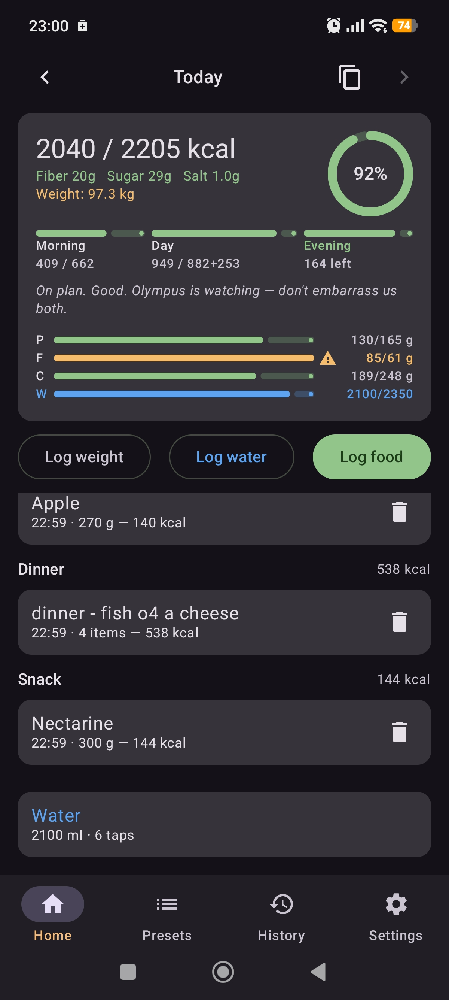
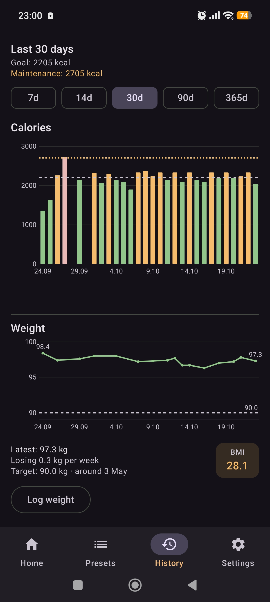
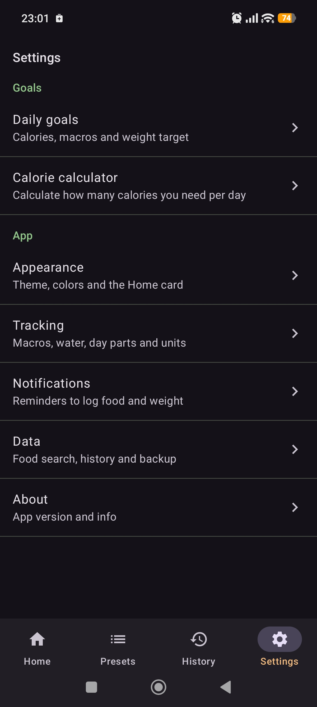

<h1 align="center">
  Diaita<br>
  <sup><sub>EAT WITH MEASURE.</sub></sup>
</h1>

<p align="center">A simple, offline-first calorie, macro and weight tracker for Android. Log meals in seconds, reuse presets, and keep an eye on your pace through the day.</p>

<p align="center">
  <a href="https://github.com/publius-github/diaita/releases/latest"></a>
  <a href="https://github.com/publius-github/diaita/releases"></a>
  <a href="https://github.com/publius-github/diaita/actions/workflows/ci.yml"></a>
  
  <a href="LICENSE"></a>
</p>

<p align="center">
  
  
  
  
  <br>
  <em>Home, Presets, History and Settings (dark theme; a light theme is included).</em>
</p>

Diaita keeps a food diary, your goals and your weight in one place, and keeps all of it on your phone. There is no account, no cloud and no telemetry: the only network use is an optional product search on OpenFoodFacts, and what it finds is cached so it keeps working offline. The app is available in English and Russian.

*Diaita* (Greek διαιτα) was the ancient Greeks' word for a way of living: the daily regimen of food, exercise and rest, the root of the word "diet".

## Install

Download `diaita-<version>.apk` from the [latest release](https://github.com/publius-github/diaita/releases/latest) and open it on your phone. Android will ask you to allow installing apps from your browser or file manager the first time. Updates install over the previous version as long as they come from the same signing key.

To check that a download came out of this repository's release workflow:

```bash
sha256sum -c diaita-<version>.apk.sha256
gh attestation verify diaita-<version>.apk --repo publius-github/diaita
```

Requires Android 8.0 or newer.

## What it does

**Food diary.** Log foods into meal slots (breakfast, lunch, dinner, snack) with day-part grouping (morning, day, evening, with configurable boundaries). The Home card shows running totals with a calorie progress ring, optional macro (P/F/C) tracking, fiber, sugar and salt against daily norms, and water. Edit quantities in place, delete with undo, copy a day or a meal, and log today's weight right from Home. A small coach compares your pace with the time of day and nudges you, with some ancient Greek flavour.

**Adding food.** Search the local catalog (about 400 common foods, seeded) with instant results, search OpenFoodFacts online (optional, can be turned off), scan a barcode, or enter a food by hand. Recent foods and favorites sit one tap away, and any catalog entry can be corrected from the search results.

**Presets and dishes.** Save recurring meals as presets and log them in one tap. Dishes are presets with a cooked weight: you weigh the portion you ate and the calories follow. Forty home-cooked dishes ship out of the box, all editable.

**Goals and history.** A goal wizard estimates your daily needs from body stats; calorie and macro targets and an optional weight target follow. History shows calories by zone against your maintenance estimate and weight with a trend line, a projected target date and a BMI tile, over 7 days to a year, with a drill-down into any day. Old entries can optionally be folded into monthly averages.

**Your data stays yours.** Full backup and restore to a single file, a weekly auto-backup into a folder you pick, CSV export and import, and optional daily reminders to log food and weight. Settings are mirrored into the database, so a backup or a reinstall brings them back too.

## Tech stack

| Area | Choice |
| --- | --- |
| Language / UI | Kotlin, Jetpack Compose (Material 3) |
| Architecture | MVVM, single Activity, manual DI (`AppContainer`) |
| Persistence | Room (exported schemas, tested migrations), DataStore Preferences |
| Networking | Retrofit + OkHttp + kotlinx.serialization (OpenFoodFacts only) |
| Background work | WorkManager (reminders, auto-backup), coroutine-based retention maintenance |
| Charts | Hand-rolled Compose `Canvas` charts (no charting library) |
| Quality | ktlint, unit tests, Room migration tests, GitHub Actions CI |

## Build from source

You need JDK 21 and, for the Android SDK, either Android Studio or the command-line tools (SDK Platform 36, which Android Studio installs on first sync). Gradle, AGP and Kotlin versions are pinned by the wrapper and the version catalog (`gradle/libs.versions.toml`); no global installs needed.

```bash
./gradlew assembleDebug      # macOS / Linux / WSL  (gradlew.bat on Windows)
./build-apk.sh [debug|release]   # same, and copies the APK into dist/
```

The debug APK lands in `app/build/outputs/apk/debug/app-debug.apk`; install it with `adb install -r <apk>`.

```bash
./gradlew ktlintCheck            # code style
./gradlew testDebugUnitTest      # unit tests
./gradlew connectedAndroidTest   # Room migration tests (needs a device or emulator)
```

### Signing a release build

Release builds are minified (R8) and signed with a keystore that is never committed. Add this to `local.properties`:

```properties
RELEASE_STORE_FILE=<path to your .jks, relative to the project root>
RELEASE_STORE_PASSWORD=...
RELEASE_KEY_ALIAS=...
RELEASE_KEY_PASSWORD=...
```

Then run `./gradlew assembleRelease`. Without these properties the release build still compiles but produces an unsigned APK, which is what CI does for pull requests.

## Releasing

Releases are built by the [`release.yml`](.github/workflows/release.yml) workflow, never on a personal machine:

1. Bump `semVer` in `app/build.gradle.kts` (`versionCode` follows from it) and describe the version in [CHANGELOG.md](CHANGELOG.md).
2. Tag the commit `v<version>` and push the tag.
3. The workflow checks that the tag, the version and the changelog agree, runs the full CI, builds and signs the APK, verifies the signature, records a build provenance attestation and attaches the APK and its checksum to a **draft** release, with the changelog entry as notes. Publish the draft by hand after a look.

One-time setup: create an environment named `release` (Settings > Environments, ideally with a required reviewer) holding the secrets `RELEASE_KEYSTORE_BASE64` (`base64 -w0 release.jks`), `RELEASE_STORE_PASSWORD`, `RELEASE_KEY_ALIAS` and `RELEASE_KEY_PASSWORD`.

## Project structure

```
app/src/main/java/app/diaita/
├── data/          # Room entities/DAOs, repositories, OpenFoodFacts client,
│                  # backup, CSV export, reminders, retention, settings
├── ui/            # One package per screen (diary, addfood, presets, goals,
│                  # history, daydetail, settings, about) + shared components
└── util/          # Small helpers
app/schemas/       # Exported Room schemas (fixtures for migration tests)
```

## Status

Pre-1.0: alpha/beta builds, released as the work goes (see the [changelog](CHANGELOG.md)). One maintainer; issues and pull requests are reviewed as time allows, with no roadmap or support commitment. Security reports go through [SECURITY.md](SECURITY.md).

## Privacy

The app makes network requests only to the OpenFoodFacts API, and only when online search is enabled. There is no analytics, no accounts and no data collection: everything is stored in a local database on the device. Food data from OpenFoodFacts is available under the [Open Database License](https://opendatacommons.org/licenses/odbl/1-0/).

## License

Copyright (c) 2026 Publius. Diaita is released under the [MIT License](LICENSE). The libraries it is built on keep their own licenses (listed in the app's About screen).
